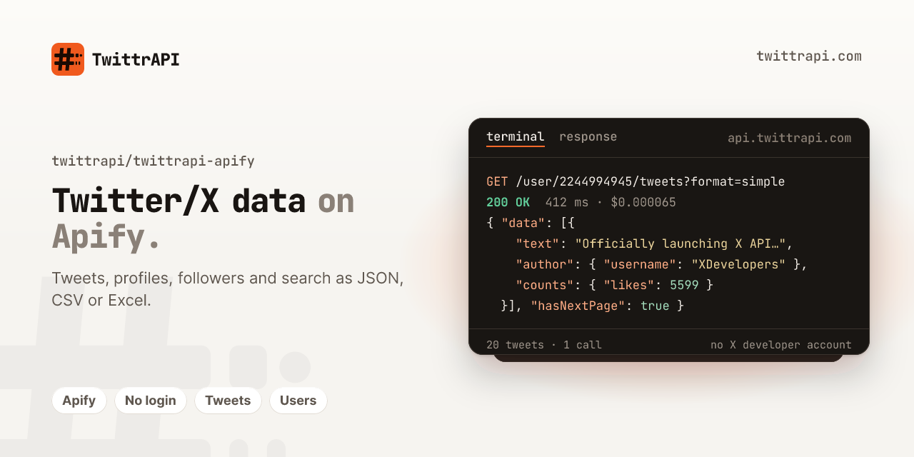

<p align="center">
  <a href="https://twittrapi.com"></a>
</p>

# twittrapi-apify – Twitter/X data Actor for Apify

[](LICENSE)

Apify Actor for [TwittrAPI](https://twittrapi.com), a REST API for public Twitter/X data: read tweets,
search results, profiles, followers, replies, retweeters, list and community tweets and trends, and get
them as clean JSON, CSV or Excel. No X account, login, cookies or proxies. Not affiliated with X Corp.

> **Get an API key:** [twittrapi.com/start](https://twittrapi.com/start?utm_source=github&utm_medium=readme&utm_campaign=twittrapi-apify) · [Pricing](https://twittrapi.com/pricing?utm_source=github&utm_medium=readme&utm_campaign=twittrapi-apify) · [Docs](https://twittrapi.com/docs?utm_source=github&utm_medium=readme&utm_campaign=twittrapi-apify) · [Status](https://twittrapi.com/status) · also available on [RapidAPI](https://rapidapi.com/viperscores-viperscores-default/api/twitter-aio)

**SDKs and integrations:** [Python](https://github.com/twittrapi/twittrapi-python) · [Node.js](https://github.com/twittrapi/twittrapi-node) · [Go](https://github.com/twittrapi/twittrapi-go) · [MCP server](https://github.com/twittrapi/twittrapi-mcp) · [n8n](https://github.com/twittrapi/n8n-nodes-twittrapi) · [Make](https://www.make.com/en/hq/app-invitation/bfe92727f14ab2c74d3c2e74281d84b1) · [LangChain](https://github.com/twittrapi/langchain-twittrapi) · [LlamaIndex](https://github.com/twittrapi/llama-index-tools-twittrapi) · [Agent skill](https://github.com/twittrapi/twittrapi-skills) · [Examples](https://github.com/twittrapi/twittrapi-examples)

**Run it on Apify:** [apify.com/kiddodev/twitter-x-data-twittrapi](https://apify.com/kiddodev/twitter-x-data-twittrapi), $0.15 per 1,000 results, no start fee.
The Store page text (modes, input examples, output fields, FAQ) is [`.actor/README.md`](.actor/README.md).
Build, test and publishing notes are in [DEVELOPMENT.md](DEVELOPMENT.md).

## Run it locally

Node.js 22 or newer and a TwittrAPI key:

```bash
git clone https://github.com/twittrapi/twittrapi-apify.git
cd twittrapi-apify
npm ci && npm run build

mkdir -p storage/key_value_stores/default
echo '{"mode": "userProfiles", "usernames": ["nasa"]}' > storage/key_value_stores/default/INPUT.json

TWITTRAPI_API_KEY=your-key npx apify-cli@1.10.0 run
```

Results land in `storage/datasets/default/`. Other modes: `searchTweets`, `userTweets`, `followers`,
`following`, `tweetReplies`, `tweetRetweeters`, `listTweets`, `communityTweets`, `trends`.

## Support

Questions, bugs or billing: [support@twittrapi.com](mailto:support@twittrapi.com) or open an issue in
this repository.

## License

MIT
